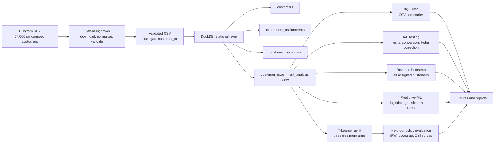

# Marketing Campaign A/B Testing & Customer Uplift Modeling

An end-to-end, reproducible marketing analytics project using a randomized
email experiment to answer two business questions:

1. **Do promotional emails increase customer engagement and revenue compared
   with sending no email?**
2. **Can customer-level modeling identify which email treatment is most
   promising for each customer?**

The project combines data engineering, SQL analytics, statistical
experimentation, predictive machine learning, and causal/uplift modeling.
It is designed as a portfolio example of how an analyst moves from raw data
to defensible business recommendations.

> **Headline:** Both promotional emails increased website visits versus the
> no-email control. Mens E-Mail was the strongest simple policy. The uplift
> model produced a slightly higher point estimate than always sending Mens
> E-Mail, but its confidence interval included no improvement, so personalized
> targeting remains a challenger strategy rather than a proven replacement.

## Project overview

Marketing teams need to distinguish **incremental response** from activity that
would have happened anyway. This project preserves the randomized experiment
design, measures treatment effects against a no-email control, and then tests
whether modeling can improve treatment selection.

The workflow deliberately separates:

- **Descriptive analysis:** who customers are and how outcomes vary.
- **Causal experiment analysis:** what changed after random assignment.
- **Predictive modeling:** which customers are likely to visit.
- **Uplift modeling:** which treatment may change a customer's outcome relative
  to another treatment.

No ROI or profitability claim is made because campaign costs, margins,
unsubscribes, and long-term customer value are not in the dataset.

## Technical skills demonstrated

| Area | Implemented capability |
|---|---|
| Python | Reusable package modules, CLI entry points, validation, reporting |
| SQL | DuckDB schema, normalized tables, analytical view, CTEs, joins, conditional aggregation, window functions |
| Experimentation | Two-treatment-versus-control testing, effect sizes, confidence intervals, Holm correction |
| Statistics | Two-proportion z-tests, bootstrap confidence intervals, uncertainty-aware interpretation |
| Machine learning | scikit-learn pipelines, one-hot encoding, scaling, validation tuning, held-out evaluation |
| Causal inference | Three-arm T-Learner, counterfactual predictions, inverse-propensity policy evaluation |
| Data engineering | Raw/processed separation, data-quality reports, relational integrity checks, reproducible orchestration |
| Communication | Educational notebooks, publication-quality figures, methodology documents, executive summary |
| Quality assurance | pytest fixtures, reproducibility checks, Ruff linting, GitHub Actions CI |

## Dataset

The project uses Kevin Hillstrom's **MineThatData E-Mail Analytics and Data
Mining Challenge**, a 64,000-customer randomized experiment.

| Assignment | Role |
|---|---|
| `No E-Mail` | Control |
| `Mens E-Mail` | Promotional treatment A |
| `Womens E-Mail` | Promotional treatment B |

The source fields include customer history, demographics, assignment, website
visits, purchases, and spend. The source does **not** provide a customer
identifier, so ingestion creates a stable one-based surrogate from source row
position and documents that decision. Exact duplicate feature rows are
retained and reported; they are not assumed to be duplicate customers.

**Source and provenance**

- Original source description: [MineThatData E-Mail Analytics and Data Mining
  Challenge](https://blog.minethatdata.com/2008/03/minethatdata-e-mail-analytics-and-data.html)
- Reproducible pinned mirror used by the pipeline:
  [hillstrom.csv](https://raw.githubusercontent.com/TerraBaseAI/campaign-decisioning-engine/c44ae9aea5923533ffdaf34522e4937afd813c9e/data/hillstrom.csv)
- Detailed provenance and cleaning decisions:
  [data/README.md](data/README.md)
- Field-level reference:
  [docs/data_dictionary.md](docs/data_dictionary.md)

## Project architecture



See the standalone [architecture document](docs/architecture.md) for the
pipeline stages, reproducibility controls, and artifact flow.

## SQL implementation

DuckDB is the main analytical engine. The original single table is represented
as three related tables:

- `customers`: pretreatment customer attributes
- `experiment_assignments`: randomized treatment assignment
- `customer_outcomes`: visits, conversions, and spend

The `customer_experiment_analysis` view joins these tables for analysis while
integrity checks confirm one assignment and one outcome per customer and no
unexpected row multiplication.

The SQL layer demonstrates `SELECT`, `WHERE`, `GROUP BY`, `ORDER BY`,
`CASE WHEN`, conditional aggregation, `COALESCE`, `NULLIF`, `INNER JOIN`,
`LEFT JOIN`, CTEs, `ROW_NUMBER()`, and `PERCENT_RANK()`. For example, this
actual project query bands historical spend and compares visitation while
retaining the full assigned-customer denominator:

```sql
WITH history_bands AS (
    SELECT
        *,
        CASE
            WHEN history < 100 THEN '01_under_100'
            WHEN history < 500 THEN '02_100_to_499'
            WHEN history < 1000 THEN '03_500_to_999'
            ELSE '04_1000_or_more'
        END AS history_band
    FROM customer_experiment_analysis
    WHERE history IS NOT NULL
)
SELECT
    history_band,
    COUNT(*) AS assigned_customers,
    AVG(history) AS average_historical_spend,
    SUM(CASE WHEN visit = 1 THEN 1 ELSE 0 END) AS visitors,
    AVG(visit) AS visit_rate
FROM history_bands
GROUP BY history_band
ORDER BY history_band;
```

The source query is [sql/14_eda_history_visit.sql](sql/14_eda_history_visit.sql).

## Experimental design and statistical analysis

Website visit is the **primary outcome** because visits are more common than
purchases. Purchase conversion and revenue per assigned customer are
secondary outcomes.

For each treatment \(T\), the primary comparison is:

\[
H_0: p_T - p_C = 0
\qquad
H_A: p_T - p_C \ne 0
\]

where \(C\) is `No E-Mail`. The implementation uses:

- Two-proportion z-tests from `statsmodels`
- Absolute effects in percentage points
- Relative percentage lift
- 95% confidence intervals
- Holm correction for the two primary treatment-versus-control tests
- Alpha \(= 0.05\)
- Exploratory secondary conversion comparisons
- Customer-level bootstrap intervals for revenue differences

Random assignment supports causal interpretation of treatment-versus-control
differences under the experiment assumptions. It does not prove that the same
effect will hold for every future audience or that revenue increases imply
profitability.

Methodology details are in [docs/experiment_design.md](docs/experiment_design.md),
[docs/ab_testing_results.md](docs/ab_testing_results.md), and
[docs/revenue_analysis.md](docs/revenue_analysis.md).

## Machine learning and uplift modeling

### Predictive classification

The predictive task is to estimate whether a customer visits the website using
only pretreatment attributes:

`recency`, `history`, `history_segment`, `mens`, `womens`, `zip_code`, `newbie`,
and `channel`.

The project explicitly excludes `treatment_group`, `visit`, `conversion`, and
`spend` from model features. It uses:

- 60/20/20 train/validation/held-out test partitions
- Stratification by treatment group and visit outcome
- `ColumnTransformer`
- `OneHotEncoder` for categorical features
- `StandardScaler` for logistic regression numeric features
- Logistic regression
- Random forest classification
- ROC-AUC, precision, recall, F1, log loss, Brier score, confusion matrices,
  ROC curves, and calibration plots

### Three-arm T-Learner uplift model

The T-Learner fits one outcome model per randomized arm:

\[
\widehat{\tau}_{Mens}(X)
 =
\widehat{P}(visit=1\mid X, Mens)
 -
\widehat{P}(visit=1\mid X, No\ E-Mail)
\]

The same calculation is performed for `Womens E-Mail`. The model estimates
counterfactual probabilities; it does not observe all three outcomes for any
one customer. Final policy evaluation uses only the reserved held-out test
set, known one-third assignment propensities, inverse-propensity weighting,
customer-level bootstrap intervals, and treatment-specific ranking/Qini curves.

Details:

- [docs/machine_learning.md](docs/machine_learning.md)
- [docs/uplift_modeling.md](docs/uplift_modeling.md)
- [docs/uplift_evaluation.md](docs/uplift_evaluation.md)

## Verified results

All values below come from generated project artifacts, not illustrative
examples. Re-run the pipeline to regenerate them.

### Experiment outcomes

| Metric | No E-Mail | Mens E-Mail | Womens E-Mail |
|---|---:|---:|---:|
| Assigned customers | 21,306 | 21,307 | 21,387 |
| Website visit rate | 10.62% | 18.28% | 15.14% |
| Purchase conversion rate | 0.57% | 1.25% | 0.88% |
| Average revenue per assigned customer | $0.65 | $1.42 | $1.08 |

Relative to `No E-Mail`, the primary visit effects were:

| Comparison | Absolute effect | 95% CI | Holm-adjusted p-value | Decision at 0.05 |
|---|---:|---:|---:|---|
| Mens E-Mail | +7.66 percentage points | +7.00 to +8.32 points | < 0.001 | Reject null |
| Womens E-Mail | +4.52 percentage points | +3.89 to +5.16 points | < 0.001 | Reject null |

Both promotional emails increased visits in this experiment. Conversion effects
were also positive, but conversion is explicitly secondary and rarer. Revenue
differences, including all $0 spenders, were:

| Comparison | Mean difference | Bootstrap 95% CI |
|---|---:|---:|
| Mens E-Mail vs No E-Mail | $0.77 | $0.50 to $1.07 |
| Womens E-Mail vs No E-Mail | $0.42 | $0.18 to $0.69 |


### Predictive modeling

| Model | ROC-AUC | Log loss | Brier score | Precision at 0.50 | Recall at 0.50 |
|---|---:|---:|---:|---:|---:|
| Logistic regression | 0.627 | 0.405 | 0.122 | 0.000 | 0.000 |
| Random forest | 0.593 | 0.415 | 0.125 | 0.000 | 0.000 |

Logistic regression had better held-out ranking and calibration metrics in this
baseline. Both models produced no positive classifications at the default
0.50 threshold because the outcome is relatively rare; probabilities and
ranking are therefore more informative than that threshold alone.


### Uplift policy evaluation

Policy values are estimated website visit rates on the held-out test set using
inverse-propensity weighting:

| Policy | Estimated visit rate |
|---|---:|
| No E-Mail for everyone | 10.59% |
| Mens E-Mail for everyone | 18.26% |
| Womens E-Mail for everyone | 15.19% |
| Highest positive estimated uplift | 18.49% |

The model policy was **+0.23 percentage points** versus always sending Mens
E-Mail, with a bootstrap 95% interval of **−0.84 to +1.27 points**. It was
**+3.30 points** versus always sending Womens E-Mail, with an interval of
**+1.97 to +4.80 points**. The first interval includes zero, so the model did
not establish a clear advantage over the simple Mens benchmark.


## Business recommendations

1. **Use Mens E-Mail as the current simple benchmark.** It led on visit rate,
   conversion rate, revenue per assigned customer, and held-out always-send
   policy value.
2. **Keep a randomized no-email holdout.** It is necessary to measure
   incremental response rather than confusing natural activity with campaign
   impact.
3. **Treat uplift targeting as an experimental challenger.** Its point estimate
   was slightly above always-Mens, but uncertainty does not establish a clear
   improvement.
4. **Do not approve a profitability decision from these results alone.** Add
   campaign costs, margin, unsubscribes, and longer-term customer value.
5. **Validate segmentation in a new randomized sample.** Test whether
   recency, historical value, and customer segments show reproducible
   incremental treatment differences before turning them into targeting rules.

## Installation and reproduction

### Requirements

- macOS, Linux, or a compatible Python environment
- Python 3.9+
- Git

### Setup

```bash
git clone <your-repository-url>
cd tech-proj2
python3 -m venv .venv
source .venv/bin/activate
python -m pip install --upgrade pip
python -m pip install -e ".[dev]"
```

### Run the complete workflow

```bash
marketing-ab-pipeline
```

The command downloads the real dataset if needed, writes the validated
processed data and DuckDB database, exports SQL summaries, runs statistical
and machine-learning analyses, evaluates uplift policies, and regenerates
figures. Randomized operations use seed `42` by default.

To require a previously downloaded raw file:

```bash
marketing-ab-pipeline --no-download
```

The pipeline never substitutes synthetic data for the real analysis. Test-only
fixtures are small synthetic datasets used for unit tests and CI.

### Run tests and linting

```bash
python -m pytest
ruff check .
```

GitHub Actions runs the same test and lint checks on pushes and pull requests.

### Run individual stages

```bash
marketing-ab-database
marketing-ab-eda
marketing-ab-statistics
marketing-ab-revenue
marketing-ab-ml
marketing-ab-uplift
marketing-ab-uplift-evaluation
marketing-ab-visualizations
```

## Educational notebooks

The notebooks are walkthroughs; reusable modules and SQL scripts are the
primary implementation.

| Notebook | What a reader learns |
|---|---|
| [01 Exploratory data analysis](notebooks/01_exploratory_data_analysis.ipynb) | DuckDB queries, customer history, experiment balance, and behavioral patterns |
| [02 A/B testing](notebooks/02_ab_testing.ipynb) | Hypotheses, effect sizes, confidence intervals, multiple-testing correction, and revenue bootstrap |
| [03 Predictive modeling](notebooks/03_predictive_modeling.ipynb) | Leakage-safe preprocessing, classification models, evaluation, and calibration |
| [04 Uplift modeling](notebooks/04_uplift_modeling.ipynb) | Potential outcomes, T-Learners, counterfactual predictions, and held-out policy evaluation |

## Repository structure

```text
.
├── data/
│   ├── raw/                    # Downloaded source data; ignored by Git
│   └── processed/              # Validated CSV, DuckDB, quality report; ignored
├── docs/                       # Methodology, architecture, data dictionary
├── models/                     # Local joblib artifacts; ignored by Git
├── notebooks/                  # Educational end-to-end walkthroughs
├── reports/
│   ├── figures/                # Generated PNG charts
│   └── *.csv, *.md             # Results tables and written reports
├── sql/                        # Schema, load, view, checks, and EDA queries
├── .github/workflows/          # Automated tests and linting
├── src/                        # Installable source package
│   └── marketing_ab/           # Reusable ingestion, analysis, ML, and CLI modules
│       ├── data_ingestion.py   # Download, load, and validation orchestration
│       ├── data_validation.py  # Cleaning rules and quality checks
│       ├── database.py         # DuckDB schema, loading, joins, integrity
│       ├── eda.py              # SQL query execution and CSV exports
│       ├── statistical_testing.py # A/B tests and Holm-adjusted inference
│       ├── revenue_analysis.py # Revenue summaries and bootstrap intervals
│       ├── machine_learning.py # Leakage-safe predictive pipelines
│       ├── uplift.py            # Three-arm logistic T-Learner
│       ├── uplift_evaluation.py # IPW policy evaluation and Qini curves
│       ├── visualizations.py   # Artifact-driven figure generation
│       └── pipeline.py         # Complete CLI orchestrator
├── tests/                      # Unit and integration-style tests
├── pyproject.toml              # Dependencies and console scripts
└── .gitignore                  # Excluded local data, models, caches, and outputs
```

## Limitations and future improvements

- The dataset has one observed outcome per customer; individual counterfactual
  outcomes are never directly observed.
- Uplift values are modeled estimates and may reflect model misspecification,
  sampling noise, feature design, and regularization.
- The source does not include costs, profit margins, delivery/open/click data,
  unsubscribes, or long-term value.
- Revenue is highly zero-inflated and right-skewed, so its mean is useful but
  incomplete as a business metric.
- The experiment is historical and may not represent a future audience or
  channel mix.
- Future work could add cost-sensitive policy learning, cross-fitting,
  doubly robust policy evaluation, stronger uplift benchmarks, prospective
  validation, and long-term customer-value outcomes.

## Why this is portfolio-ready

From a hiring-manager perspective, this project demonstrates more than a
notebook model:

- It starts with a real, documented randomized dataset.
- It preserves raw data and validates assumptions before analysis.
- It uses SQL and a relational database rather than relying only on pandas.
- It separates causal experimentation from predictive modeling.
- It prevents leakage and reserves a held-out test set for final evaluation.
- It reports uncertainty and limitations instead of overstating results.
- It provides a reproducible CLI, tests, CI, generated artifacts, and clear
  business recommendations.

The concise executive-facing report is available at
[reports/executive_summary.md](reports/executive_summary.md).
