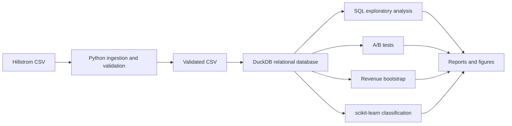

# Marketing Campaign A/B Testing & Introductory Machine Learning

This repository contains an end-to-end, reproducible marketing analytics
project using a randomized email experiment and beginner-friendly
scikit-learn classification models.

The project answers two practical questions:

1. Do promotional emails increase website visits, purchases, and revenue
   compared with sending no email?
2. Can basic machine learning predict which customers are more likely to visit?

The analysis focuses on data ingestion, SQL, A/B testing, bootstrap confidence
intervals, and introductory machine learning.

## Technical skills demonstrated

| Area | Implemented capability |
|---|---|
| Python | Reusable modules, validation, reporting, and command-line entry points |
| SQL | DuckDB schema, normalized tables, joins, CTEs, conditional aggregation, and window functions |
| Experimentation | Treatment-versus-control comparisons, effect sizes, confidence intervals, and Holm correction |
| Statistics | Two-proportion tests and customer-level bootstrap confidence intervals |
| Machine learning | scikit-learn preprocessing pipelines, logistic regression, decision tree, and standard classification metrics |
| Data engineering | Raw/processed separation, data-quality reports, relational integrity checks, and reproducible orchestration |
| Quality assurance | pytest fixtures, reproducibility checks, Ruff linting, and GitHub Actions CI |

## Dataset

The project uses Kevin Hillstrom's **MineThatData E-Mail Analytics and Data
Mining Challenge**, a 64,000-customer randomized experiment.

| Assignment | Role |
|---|---|
| `No E-Mail` | Control |
| `Mens E-Mail` | Promotional treatment A |
| `Womens E-Mail` | Promotional treatment B |

The source does not provide a customer identifier, so the ingestion module creates
a stable one-based surrogate from source row position. Exact duplicate feature
rows are reported and retained because they are not evidence of duplicate
customers.

**Source and provenance**

- Original source description: [MineThatData E-Mail Analytics and Data Mining
  Challenge](https://blog.minethatdata.com/2008/03/minethatdata-e-mail-analytics-and-data.html)
- Pinned mirror used by the pipeline:
  [hillstrom.csv](https://raw.githubusercontent.com/TerraBaseAI/campaign-decisioning-engine/c44ae9aea5923533ffdaf34522e4937afd813c9e/data/hillstrom.csv)
- Cleaning decisions: [data/README.md](data/README.md)
- Field reference: [docs/data_dictionary.md](docs/data_dictionary.md)

## Project architecture



See [docs/architecture.md](docs/architecture.md) for the detailed data flow.

## SQL implementation

The data is stored in DuckDB using three related tables:

- `customers`: pretreatment customer attributes
- `experiment_assignments`: randomized treatment assignment
- `customer_outcomes`: visits, conversions, and spend

These tables are joined through the `customer_experiment_analysis` view. The
SQL implementation demonstrates joins, CTEs, conditional aggregation, `CASE`,
`COALESCE`, `NULLIF`, `ROW_NUMBER()`, and `PERCENT_RANK()`.

Example from [sql/14_eda_history_visit.sql](sql/14_eda_history_visit.sql):

```sql
WITH history_bands AS (
    SELECT
        *,
        CASE
            WHEN history < 100 THEN '01_under_100'
            WHEN history < 500 THEN '02_100_to_499'
            WHEN history < 1000 THEN '03_500_to_999'
            ELSE '04_1000_or_more'
        END AS history_band
    FROM customer_experiment_analysis
)
SELECT
    history_band,
    COUNT(*) AS assigned_customers,
    AVG(visit) AS visit_rate
FROM history_bands
GROUP BY history_band
ORDER BY history_band;
```

## Experimental design and statistical analysis

Website visit is the primary outcome because it is more common than purchase
conversion. Conversion and revenue per assigned customer are secondary
outcomes.

For each treatment `T` versus the `No E-Mail` control `C`, the hypotheses are:

```text
H0: p_T - p_C = 0
HA: p_T - p_C != 0
```

The analysis uses two-proportion z-tests, absolute effects in percentage
points, relative lift, 95% confidence intervals, and Holm correction for the
two primary visit comparisons. The significance level is `alpha = 0.05`.
Revenue analysis includes every randomized customer, including customers with
zero spend, and uses a reproducible customer-level bootstrap.

Methodology details:

- [docs/experiment_design.md](docs/experiment_design.md)
- [docs/ab_testing_results.md](docs/ab_testing_results.md)
- [docs/revenue_analysis.md](docs/revenue_analysis.md)

## Introductory machine learning

The machine learning task is binary classification: it predicts whether a
customer visits the website using pretreatment attributes only:

`recency`, `history`, `history_segment`, `mens`, `womens`, `zip_code`, `newbie`,
and `channel`.

The models do not use `visit`, `conversion`, `spend`, or treatment assignment as
input features. The implementation uses:

- A stratified 60/20/20 train/validation/test split
- `ColumnTransformer`
- `OneHotEncoder` for categorical features
- `StandardScaler` for numeric features in logistic regression
- Logistic regression as an interpretable baseline
- Decision tree as a simple nonlinear tree-based comparison
- Small validation-based hyperparameter searches
- Held-out ROC-AUC, precision, recall, F1, log loss, Brier score, and confusion matrices

### Logistic regression

Logistic regression estimates the probability of a binary outcome. It is a
useful first model because its coefficients and probability outputs are easier
to explain than more complex models.

### Decision tree

A decision tree learns a sequence of feature-based rules that divide customers
into smaller groups. It can represent nonlinear patterns and is easy to
visualize, but a deep tree can memorize training data. Tree depth and minimum
leaf size are limited during validation to reduce overfitting.

These models estimate the likelihood of a website visit from the available
pretreatment attributes. This prediction task is separate from measuring the
effect of changing a customer's email assignment.

Implementation details are in [docs/machine_learning.md](docs/machine_learning.md)
and [src/marketing_ab/machine_learning.py](src/marketing_ab/machine_learning.py).

## Verified results

### Experiment outcomes

| Metric | No E-Mail | Mens E-Mail | Womens E-Mail |
|---|---:|---:|---:|
| Assigned customers | 21,306 | 21,307 | 21,387 |
| Website visit rate | 10.62% | 18.28% | 15.14% |
| Purchase conversion rate | 0.57% | 1.25% | 0.88% |
| Average revenue per assigned customer | $0.65 | $1.42 | $1.08 |

Relative to `No E-Mail`, the primary visit effects were:

| Comparison | Absolute effect | 95% CI | Holm-adjusted p-value |
|---|---:|---:|---:|
| Mens E-Mail | +7.66 percentage points | +7.00 to +8.32 points | < 0.001 |
| Womens E-Mail | +4.52 percentage points | +3.89 to +5.16 points | < 0.001 |

Revenue differences, including all zero-spend customers, were:

| Comparison | Mean difference | Bootstrap 95% CI |
|---|---:|---:|
| Mens E-Mail vs No E-Mail | $0.77 | $0.50 to $1.07 |
| Womens E-Mail vs No E-Mail | $0.42 | $0.18 to $0.69 |

### Predictive model results

| Model | ROC-AUC | Log loss | Brier score |
|---|---:|---:|---:|
| Logistic regression | 0.627 | 0.405 | 0.122 |
| Decision tree | 0.606 | 0.408 | 0.123 |

Logistic regression performed better on the held-out comparison. Both models
produced no positive classifications at the default 0.50 threshold because
the visit outcome is relatively rare; probability ranking and calibration are
more informative than that threshold alone.

Figures are generated in [reports/figures/](reports/figures/), including visit
rates, revenue, model performance, ROC curves, and calibration.

## Installation and reproduction

### Requirements

- macOS, Linux, or a compatible Python environment
- Python 3.9+
- Git

### Setup

```bash
git clone https://github.com/abrarhuda/marketing-campaign-uplift.git
cd marketing-campaign-uplift
python3 -m venv .venv
source .venv/bin/activate
python -m pip install --upgrade pip
python -m pip install -e ".[dev]"
```

### Run the complete workflow

```bash
marketing-ab-pipeline
```

This command downloads the real dataset if needed, validates it, builds the
DuckDB database, exports SQL summaries, runs A/B tests and revenue analysis, trains
the two scikit-learn models, evaluates them, and regenerates figures.
Randomized operations use seed `42` by default.

To require a previously downloaded raw file:

```bash
marketing-ab-pipeline --no-download
```

### Run tests and linting

```bash
python -m pytest
ruff check .
```

GitHub Actions runs the same test and lint checks on pushes and pull requests.

### Run individual stages

```bash
marketing-ab-database
marketing-ab-eda
marketing-ab-statistics
marketing-ab-revenue
marketing-ab-ml
marketing-ab-visualizations
```

## Educational notebooks

The notebooks demonstrate the workflow while reusable modules and SQL scripts
remain the primary implementation.

| Notebook | What a reader learns |
|---|---|
| [01 Exploratory data analysis](notebooks/01_exploratory_data_analysis.ipynb) | DuckDB queries, customer history, experiment balance, and behavioral patterns |
| [02 A/B testing](notebooks/02_ab_testing.ipynb) | Hypotheses, effect sizes, confidence intervals, multiple-testing correction, and revenue bootstrap |
| [03 Predictive modeling](notebooks/03_predictive_modeling.ipynb) | Feature selection, preprocessing, logistic regression, decision tree, and evaluation |

## Repository structure

```text
.
├── data/                    # Raw and validated data; local files are ignored
├── docs/                    # Methodology, architecture, and data dictionary
├── models/                  # Local scikit-learn joblib artifacts; ignored
├── notebooks/               # Educational walkthroughs
├── reports/                 # Results tables, figures, and executive summary
├── sql/                     # Database schema, loading, checks, and EDA queries
├── .github/workflows/       # Automated tests and linting
├── src/marketing_ab/        # Reusable ingestion, analysis, ML, and CLI modules
├── tests/                   # Unit and integration-style tests
├── pyproject.toml           # Dependencies and console scripts
└── .gitignore               # Excluded local data, models, caches, and outputs
```

## Limitations and future improvements

- The models predict visits rather than estimate individual treatment effects.
- Predictive performance is limited by the available pretreatment features.
- Revenue is zero-inflated and right-skewed, so its mean is useful but
  incomplete as a business metric.
- The source does not include costs, profit margins, delivery/open/click data,
  unsubscribes, or long-term customer value.
- The experiment is historical and may not represent a future audience or
  channel mix.
- Future work could add feature engineering, threshold selection based on
  business costs, cross-validation, and prospective validation on a new sample.
