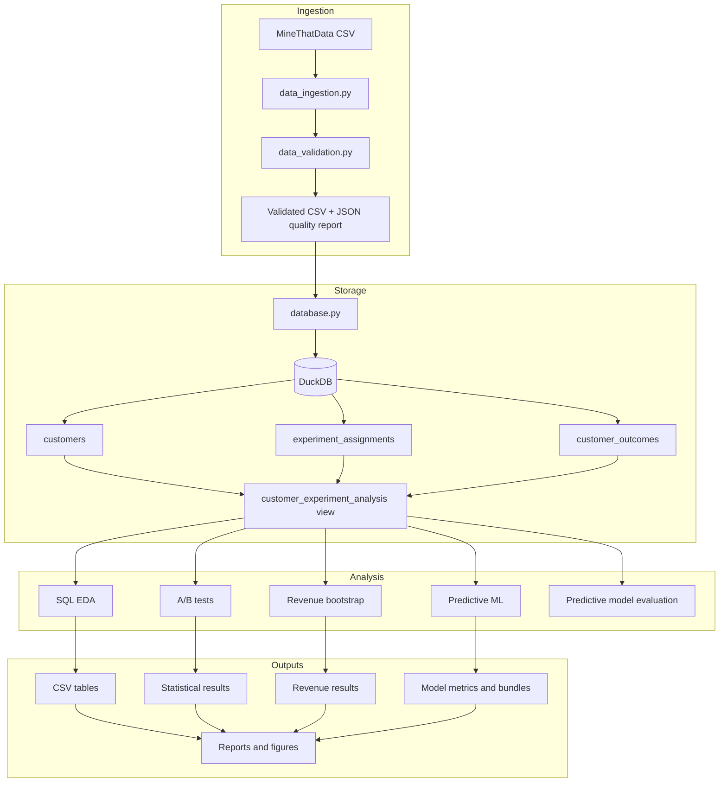

# Project architecture

I organized the project as a reproducible data-to-analysis pipeline. I never
overwrite raw source data, I keep analytical transformations explicit, and I
use a reserved test set for final model evaluation.



## Stage responsibilities

| Stage | Primary implementation | Reproducibility control |
|---|---|---|
| Ingestion | `data_ingestion.py`, `data_validation.py` | Pinned source URL, raw/processed separation, explicit validation failures |
| Database | `database.py`, `sql/01`–`04` | Deterministic schema, primary/foreign keys, join and row-count checks |
| SQL EDA | `eda.py`, `sql/05`–`14` | Queries are versioned and exported as CSV tables |
| A/B testing | `statistical_testing.py` | Fixed definitions, Holm correction, explicit comparison direction |
| Revenue | `revenue_analysis.py`, `sql/15` | Seed `42`, 2,000 customer-level bootstrap iterations, zero spend included |
| Predictive ML | `machine_learning.py` | Seed `42`, stratified 60/20/20 split, preprocessing inside pipelines |
| Visualization | `visualizations.py` | Figures regenerated from saved analysis artifacts |
| Orchestration | `pipeline.py` | One documented command and consistent project-root paths |

## Relational design

The source CSV is normalized into three logical tables:

```text
customers(customer_id PRIMARY KEY, pretreatment attributes...)
experiment_assignments(customer_id PRIMARY KEY, treatment_group,
                        FOREIGN KEY customer_id -> customers)
customer_outcomes(customer_id PRIMARY KEY, visit, conversion, spend,
                  FOREIGN KEY customer_id -> customers)
```

This design makes assignment, customer attributes, and outcomes explicit while
retaining the one-row-per-customer structure of the original experiment. I use
the analytical view as a convenient read model for SQL, statistics, and
machine learning.

## Leakage and evaluation boundaries

I separate pretreatment features from post-assignment outcomes and use only the
former for prediction. I select models with training and validation data, then
use the held-out test partition for final evaluation.
